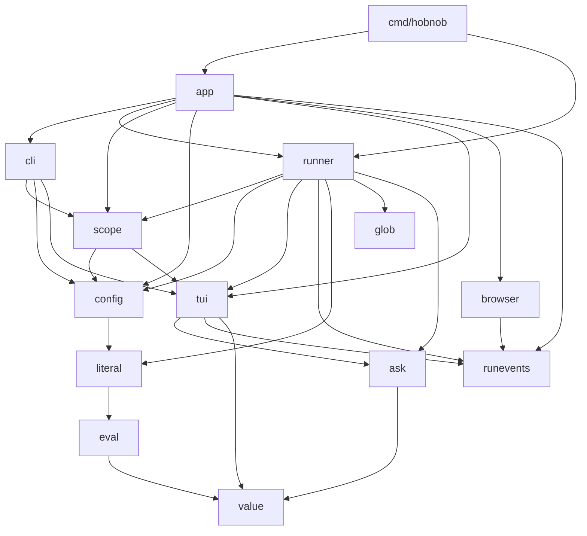
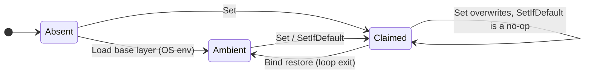
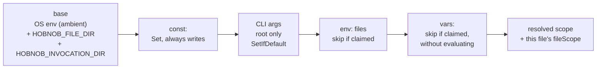
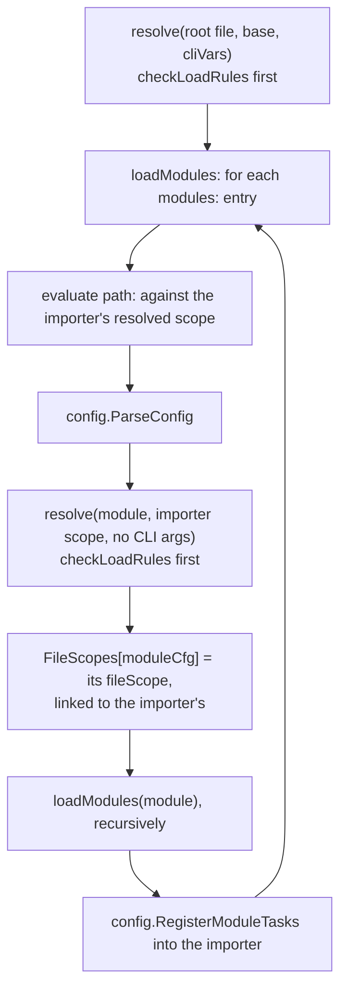
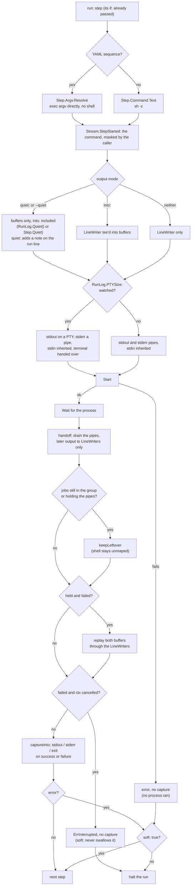
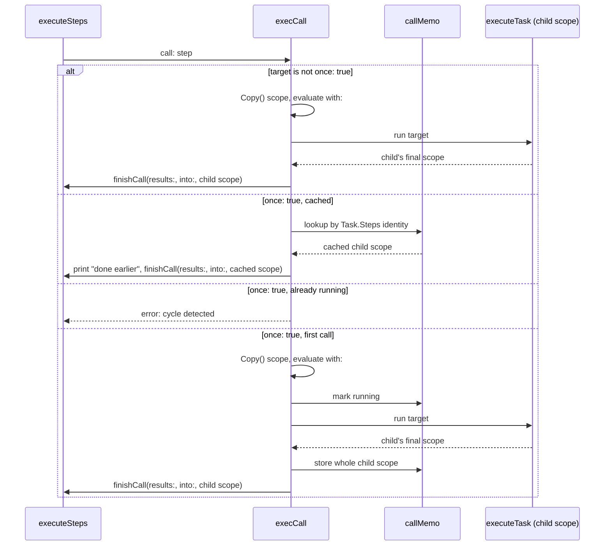
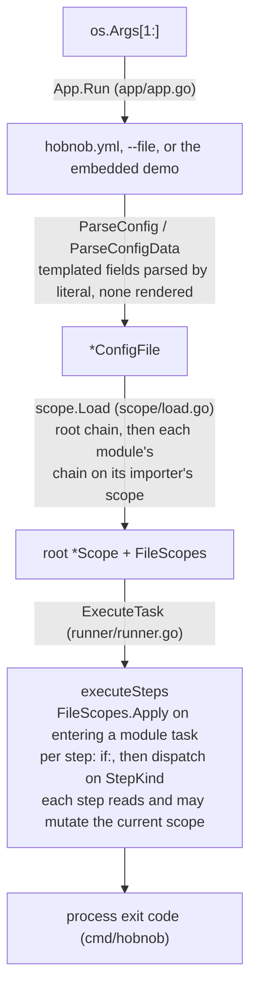

# Architecture

Hobnob is one Go binary: a YAML task runner built on a **timeline**, not a
dependency graph. A task is a list of steps. Variables, conditions and prompts
resolve in order as execution reaches each one. Two decisions shape everything:

1. **Nothing is evaluated at parse time.** Every template field is parsed
   once, at load, and rendered against the scope as it stands when execution
   reaches it.
2. **A variable is a typed value, not text.** nil, string, bool, number, array
   or object. JSON captured from a command stays structured for the whole run.

Domain terms (layer, precedence, upward read, file scope) are defined in
[CONTEXT.md](CONTEXT.md). Dev tasks live in `hobnob.yml` (`hobnob --list`).

## Key invariants

Every change must preserve these. Each is explained in the section named.

- **Deferred evaluation.** Templates render only at runtime, through
  `EvalTemplate`/`EvalValue`. A templated field is parsed at load into a
  `literal.Expr`, `Into` or `Argv`, and only their evaluators render it.
  ([literal](#internalliteral-references-and-literals))
- **Call isolation.** Every `call:` runs in a `Scope.Copy()`; only what the
  call contract (`config.CallInto`) projects comes back: its `into:` (even
  `into: []`), or with none, the target's `results:`, checked present on every
  call by `config.CallSource`, which also keeps every `_`-prefixed variable
  out. The load-time const check and `finishCall` both ask `CallInto`. The
  `once:` memo is keyed on `Task.Steps` identity and caches the whole child
  scope. ([runner](#internalrunner-the-interpreter))
- **Per-file load rules.** Each file is checked against its own blocks:
  `scope.checkLoadRules` (`checkConstClosedWorld`, `checkVarsNoSelfReference`,
  `checkEnvPathsDontReferenceVars`) at the top of `scope.resolve`, before that
  file's chain evaluates anything, and `config.checkConstNamesNotShadowed` at
  parse. A step's keys and writes come only from its row in
  `config.stepKinds`: parsing rejects a second kind key or a foreign key, and
  the const check asks `Step.Writes`.
  ([scope](#internalscope-the-runtime-scope-and-file-scopes),
  [config](#internalconfig-parsing))
- **One resolution chain.** The ADR-0001 order exists only in `scope.resolve`
  and `Scope.envFileRef` beside it (the same order for `$NAME` inside a
  dotenv file), for root and modules alike. The load rules that follow from
  that order, and the two built-in names, are defined once beside it
  (`scope/loadrules.go`). A module's file scope never leaks to its parent;
  `FileScopes.Apply` lands its `const:` with `Set` and its `env:`/`vars:` with
  `SetIfDefault`. Every `Set` claims its name. ([scope](#internalscope-the-runtime-scope-and-file-scopes))
- **Private scope maps.** Writes go through `Set`/`SetIfDefault`/`MarkSecret`/
  `Bind`; output masking reads secrets only through `Mask`/`Display`.
- **A run owns its steps' process groups.** A `run:` step ends when its
  shell exits; jobs it left running keep going, and `ExecuteTask` stops them
  (`stopLeftovers`) before it returns, on every exit path. A step's shell
  stays unreaped while its group may be signalled, so the group ID can't be
  reused: its PID stays registered until then, and a leftover's shell until
  its group is empty or the run ends. Output after the shell exits never
  reaches `into:` or a held (`quiet:` or `--quiet`) buffer. ([runner](#internalrunner-the-interpreter))
- **Hidden tasks.** `Task.Hidden` is true for `_`-prefixed tasks and for tasks
  from `_`-prefixed modules: they run, but stay out of `--list`.
- **Prompt seam.** The runner asks through the `runner.Prompts` (ask, path,
  say) its caller passes to `ExecuteTask`; the terminal front end passes `runner.TerminalPrompts()`,
  or the page's prompts (`browserPrompts`) under `--browser`. A text or menu
  `get:` entry is one `ask.Question` whose `Judge` owns the answer rules
  (default fallback, required refusal, skip, `match:`/`check:`, every refusal's
  wording); a front end only presents the question and hands back an
  `ask.Answer`, never re-deriving those rules.
  Tests swap those terminal prompts with `runner.SetPrompts(ask, path, say)
  (restore func())`, never by reassigning a package variable.
- **One event stream.** The runner reports a run only to the `runevents.Stream`
  it is given, and never to a front end directly. The terminal `RunLog` and the
  browser `state` are listeners on it. Which failure ended a run, and the task
  it names, is decided in the stream (`Finish`), not in a listener.
  ([runevents](#internalrunevents-the-run-event-stream))
- **The browser stays a front end.** `internal/browser` is a `runevents.Listener` and
  imports `value`, `ask`, `runevents`, and `tui` only for path prompts (`PathPrompt` and its
  shared rules), never `eval`,
  `runner` or `config`;
  it observes a run through the stream and never changes
  what the runner does. ([browser](#internalbrowser-the-browser-front-end))
- **One sniff point.** Only `value.Capture` turns text into structure, and
  only for `run: into:` and CLI args ([ADR-0005](docs/adr/0005-cli-args-read-as-json.md)).
  `keys`, `join` and accessors error on a String, naming `| json`, rather
  than parse it.
  ([value](#internalvalue-the-typed-scope-value))
- **Absence defers; wrong kind fails.** A missing path is a `value.Missing`
  sentinel that only `| default` catches; every other consumer raises it. A
  wrong-kind access is always an immediate error. ([value](#internalvalue-the-typed-scope-value))

## Package layout

```
cmd/hobnob/       entry point: signal handling, exit codes
internal/app/     the CLI body: flag dispatch, App.Run(ctx, args)
internal/runner/  step execution (the interpreter loop)
internal/scope/   the runtime scope, loading the root and module file scopes, and their load rules
internal/cli/     --list/--help, completions
internal/ask/     the question a text or menu get: entry puts to a front end, and the judge of its answer
internal/runevents/ the run's event stream: every event, the failure bookkeeping and the outcome
internal/tui/     bubbletea prompts, lipgloss styles, the run log and output line writers
internal/browser/ the --browser front end: local page, SSE snapshots, the run listener's state
internal/config/  YAML into typed structs, the step-level load-time check
internal/literal/ references, literals and argv: parsed at load, evaluated at run time
internal/eval/    template rendering, accessor rewriting, shell evaluation
internal/value/   the typed scope value, its filters and accessor engine
internal/glob/    match: path patterns compiled to a matcher (doublestar)
internal/termsim/ replays a terminal's output stream onto a grid, for tests
internal/e2e/     end-to-end CLI suite (test files only)
tools/testconventions/  golangci-lint plugin enforcing the test shape (its own Go module)
```

Imports run one way. An arrow means "imports":



For readability the graph omits the direct `eval`/`value` imports from
`config`, `scope`, `cli`, `runner` and `app`. See the real graph with
`go list -f '{{.ImportPath}}: {{join .Imports " "}}' ./internal/...`.

- `value` imports only the stdlib.
- `literal` imports `eval` and `value`, never `config`; `eval` imports
  neither. `runner` names `literal.Expr` only for a call's `dir:`.
- `ask` imports only `value`; `runner` builds its `Question`, and `tui` and
  `browser` import it to present one, so no front end imports `runner`.
- `tui` imports `value` and `ask` but not `eval`: `PromptAsk` takes a
  `Question` whose `Check` closure the runner built, and `PromptPath` takes `Included`/`Excluded` predicates built by the runner
  from `internal/glob`, so the prompt layer never learns how a shell condition
  or a `match:` pattern works.
- `scope`, not `config`, walks modules: a module path is evaluated against its
  importer's resolved scope, and `config` cannot import `scope`. `scope`
  imports `tui` only for `SecretMask` and `HobnobWarning` (`envfiles.go`).
- `runevents` imports only the stdlib (and `ansi`, to strip output lines);
  `runner`, `tui`, `browser` and `app` import it, so a front end hears a run
  without importing `runner`.
- `browser` imports `value`, `ask`, `runevents`, and `tui` only for path prompts (`PathPrompt`, its
  `Included`/`Excluded` predicates, and the picker rules `IsJunk`,
  `ResolvePath`, `ListDir`, `NearestFolder` and `PathPrompt.Allows` that
  the terminal and the page share). `app` imports it.
- Only `internal/e2e` (all `_test.go`) imports `app`.

### `internal/value`: the typed scope value

`Value` wraps nil, `string`, `bool`, `json.Number`, `[]any` or
`map[string]any`, recursively, so `Any()` feeds the accessor engine as is.
Numbers are `json.Number`, never `float64`: no precision loss, no stray `.0`.
A seventh kind, `KindMissing`, lives only inside one accessor evaluation.

**`Capture(text)` is the one sniff point.** Text becomes structure only if it
decodes cleanly as a JSON array or object. Its callers are `run: into:` and
`scope.resolve` for CLI args. Env vars, env-file values and prompt answers go
through `Str`, unsniffed. The `json` filter is the explicit way in.

**`Filters` is the one filter registry**, serving text/template (as a
`FuncMap`, adapted in `eval`), the type-preserving evaluator, and `into:`
pipes.

**`Path` (`path.go`) evaluates an accessor chain** like
`.A.b[0][.KEY][1:3][*]`, dispatching on the container's kind, not the key's
shape. After a star or slice, later steps map over the nodes and drop
non-matches. Results come back as `PathCall`/`StarCall`/`SliceCall`.

**Absence defers; wrong kind fails.** A missing key or out-of-range index
yields `Missing`, so a later `| default` in the same pipeline can catch it.
Every other consumer raises it first: the `adaptFilter`/`evalFilterCommand`
guard, `equalValues`/`orderValues`, `EvalValue`'s final check, and
`EvalTemplate`'s marker scan (`ScanMissing`, needed because `Value.String()`
is an `fmt.Stringer` and cannot return an error). Indexing a string or slicing
an object errors immediately, and `default` never catches it.

`ShellQuote` (behind `quote` and `eval.SourceShellFile`) lives here because
`eval` imports `value`, not the reverse.

### `internal/eval`: templates, accessors, shell

Everything renders through `text/template` against `map[string]value.Value`.

- **`EvalTemplate(tmpl, vars)`** renders to a string. `templateFuncs` is built
  once at init because this is the hottest path. It overrides
  `eq`/`ne`/`lt`/`le`/`gt`/`ge`, since the builtins compare on `reflect.Kind`,
  which for a `Value` is always `Struct`.
- **`EvalValue(expr, vars)`** preserves type. When `expr` is one action on one
  var, through optional accessor and filter chains, it evaluates the parse tree
  directly against `value.Filters`/`value.Path`. Anything else falls back to
  `EvalTemplate` and returns a String. This is why `options: .TYPES` and
  `- run: [curl, .CURL_OPTS]` keep their types.
- **`EvalCondition(ctx, expr, vars, dir)`** renders, then runs `sh -c`; exit 0
  is true. Backs `if:` and `check:`. Cancellation kills the shell, so CTRL+C
  never hangs on a condition. `EvalCheckWithOverride` tests a candidate answer
  without committing it to scope.
- **`EvalIntoLeaf(leaf, source, vars)`** (`into.go`) is the one `into:` leaf
  grammar for `run:` and `call:`, which `literal.Into` calls for each leaf. A `{{ }}` leaf is a template over the
  caller's scope. Otherwise the head name (leading `.` optional) resolves
  through an `IntoSource` (`stdout`/`stderr`/`exit`, or the child's vars), and
  the rest of the leaf (`NAME|trim` works unspaced) runs through `EvalValue`'s
  typed evaluator, with the caller's vars underneath for dynamic keys. A head
  the source lacks is `Missing`. Capture happens at the source, not the chain's
  end, so a string leaf that looks like JSON stays a string.
- **`ReferencedVars(expr)`** (`refs.go`) collects every top-level var a
  template touches, dynamic keys included. `literal.Expr.Refs` and the `env:`
  path check use it.
- Shared helpers: `ResolvePath` (relative to the taskfile dir), `SplitKV` (the
  `KEY=VALUE` rule for CLI args, `os.Environ()` and env files), `CloneMap`,
  `ResolveItems`/`ItemsFromValue` (`loop:`, `options:`), and `IsBareRef`/
  `IsParenRef`, the accessor scanner `literal`'s reference grammar is built
  on.

**The accessor rewriter (`accessor.go`) is the one piece of real machinery.**
text/template has no bracket subscripts, and hobnob does not fork it. Before
every parse, `rewriteAccessors` lexes each `{{ }}` action and rewrites accessor
chains into calls to `hbpath`/`hbstar`/`hbslice`. Text outside actions and
inside string, rune and raw literals passes through untouched, so a quoted
`}}` or `[` is never syntax.

Those funcs are registered twice: `chainvalue.go`'s typed evaluator calls
`value.PathCall`/`StarCall`/`SliceCall` directly, and the `FuncMap` holds
reflection wrappers for shapes it does not recognize (a bare `{{ .A.b }}`, an
accessor as an `eq` argument).

`SourceShellFile` (`shell.go`) sources a `.sh` env file in a subshell and diffs
against a baseline `env`, so noise like `SHLVL` stays out.

### `internal/config`: parsing

`ParseConfig(path)` reads a file; `ParseConfigData(data, filePath, dir)` parses
bytes, which is how the embedded `--demo` loads. Both walk a `yaml.Node` into
a `ConfigFile`. An unknown top-level key is a load error, so `taks:` fails.

Every templated field is parsed by `literal` (see below) and stored
unevaluated. `const:`/`vars:` are no exception: their values still defer to
`scope.Load`; only their reference structure (`Expr.Refs`) is inspected here.
`config` keeps the entry-list syntax around those values: the
`{ value:, secret: }` form, bare `into:` names, and the wording for a spread
written as a whole entry, which it gives when `literal.ErrSpread` comes back.

`const:`, `vars:` and `env:` are syntax only here: the rules about what they
may reference follow from the layer order, so they live beside it in `scope`.
The one load-time rule `config` keeps is about steps:

- `checkConstNamesNotShadowed` (`constvars.go`): no name a step writes
  (`Step.Writes`) may be a `const:` name of its own file. That covers
  `set:`/`get:`/`into:` targets, a `call:`'s `with:` keys (whatever the
  target, since they'd outrank `const:` in the called task), `loop:`
  iterators (a templated source counts `ITEM`, `KEY` and `VALUE`, since its
  kind is only known at runtime), and what `CallInto` projects for a call to
  a literal target in the same file.

`use:` and `rerun:` are parse errors naming `call:`/`once:` as the replacement.

**Step kinds** (`stepkinds.go`). `config.Step` stays one flat struct, but each
kind's rules sit in one row of the `stepKinds` table: the key that selects it,
the keys it takes besides `if:`, and a `writes` func. `stepKindOf` picks a
step's kind before any field is parsed, rejecting zero or several kind keys
and any key the kind doesn't take, so the runner can trust that, say, `soft:`
only appears on `run:` and `call:`. `Step.Writes(tasks)` returns every caller
name a step may write, a `loop:` body's included.

**The call contract** (`call.go`) answers what a `call:` hands back, for load
time and runtime alike:

- `CallInto(step, target)`: the `into:` entries the call applies; their
  `ParentKey`s are the caller names it writes. A written `into:` (`HasInto`,
  even `[]`) is taken as is; with none, the target's `results:` as bare
  entries. A target unknown at load passes as the zero `Task`.
- `CallSource(target, childVars)`: checks the `results:` promise, then
  returns the `into:` source over the child's vars: an unset name is
  `Missing`, a `_`-prefixed one a hard error.

**Modules.** `modules.go` parses an entry into a `ModuleEntry` (raw path,
`show:`/`hide:`/`flatten:`). `RegisterModuleTasks` applies those filters and
registers the tasks into the importer under namespaced names. Walking imports
and reading `env:` files belong to `scope`.

### `internal/literal`: references and literals

The one home of the [reference](CONTEXT.md) and [literal](CONTEXT.md)
grammar. A field's YAML parses here once, at load; what comes back evaluates
against the scope at run time. Three types, each a constructor and an
evaluator:

| Type   | Parsed by                     | Holds                                   | Evaluated by                         |
| ------ | ----------------------------- | --------------------------------------- | ------------------------------------ |
| `Expr` | `Single(raw)`, `Parse(name, n)` | one template, or a list/map literal     | `Value(vars)` typed, `Text(vars)` rendered |
| `Into` | `ParseInto(name, n)`, `IntoLeaf(name)` | one `into:` leaf, or a literal of leaves | `Eval(source, vars)` via `eval.EvalIntoLeaf` |
| `Argv` | `ParseArgv(n)`                | `run:`'s list form                      | `Resolve(vars)`                      |

- **References.** A field that is one reference (`options: .VAR[0].name`,
  `.X | json`) is wrapped in `{{ }}` when `eval.IsBareRef` matches, so
  `Value` keeps its type. Everything else is stored as written. `Single` is
  every single-value field: `run:`, `dir:`, `quiet:`, `loop:`, `options:`,
  `default:`. Raw-text fields (`if:`, `info:`, `call:`, `check:`, `env:` and
  module paths) never come here.
- **Literals.** `Parse` and `ParseInto` turn a `set:`/`with:`/`const:`/
  `vars:`/`into:` map or list into a tree of string leaves and typed scalars
  (YAML aliases followed, map keys free of template syntax). Evaluating one
  walks the tree, evaluating each leaf and assembling a real Go tree, never
  round-tripping through JSON text, so a leaf holding a quote or backslash
  cannot corrupt the structure. `name` roots the field path in error
  messages (`B.k`).
- **Spread** ([ADR-0004](docs/adr/0004-list-spread-in-literals.md)). A list
  element written `REF...`, one reference (a `.NAME` or a parenthesised
  pipeline, `eval.IsParenRef`) followed by `...`, has its items appended in
  place of one element; any other kind errors, naming `| json` for a string.
  An `into:` leaf's spread is any non-template leaf ending in `...`. Text that
  merely ends in `...` is not a spread. A spread anywhere else (a single-value
  field, an object field) fails at load with an error wrapping `ErrSpread`.
- **Argv.** `Resolve` splices an array into one argument per item (empty
  splices to nothing), errors on an object naming the accessor fix, and keeps
  an empty element as one empty argument so later positions never shift. A
  spread element resolves as its reference does.
- **`Expr.Refs`** returns every name an `Expr` reads, spreads included: the
  `const:`/`vars:` load rules use it.

### `internal/scope`: the runtime scope and file scopes

`Scope` keeps five private maps, so no write skips the bookkeeping:

| Map       | Holds                                                                   |
| --------- | ----------------------------------------------------------------------- |
| `vars`    | the values, read through `Vars()` (live map, read-only by convention)   |
| `secrets` | names flagged secret, read through `IsSecret`                           |
| `ambient` | names whose value still comes only from the OS env base layer           |
| `fromCLI` | names whose value is a command-line argument nothing has overwritten   |
| `carried` | secret values `Adopt` brought up from a `call:` child, without a name   |

Writes go through four methods:

- `Set` overwrites, propagates the secret flag, and clears `ambient` and `fromCLI`.
- `SetIfDefault` fills only an unclaimed name.
- `MarkSecret` flags a name already in scope (a `get: secret:` on a set var).
- `Bind(key, val) (restore func())` sets a `loop:` iterator; `restore` puts
  back the prior value and flags, or removes the key.

`resolve` sets `fromCLI` for the root's `cliVars`; `Copy` carries it and `Bind`'s `restore` puts it back. The one
query, `FromInvocation(key)`, is true for a `fromCLI` or `ambient` name: the
value still comes from where hobnob was run, so a relative path in it resolves
against `HOBNOB_INVOCATION_DIR` (see `get:`'s path checks).

**The claimed rule.** A name is _claimed_ when present and not ambient. Only
`Load`'s base layer marks ambient; every `Set` clears it. That one rule decides
every default-tier write:



**Masking.** `Mask(text)` redacts each secret's raw and JSON-escaped forms,
named and `carried` alike, skipping bools and numbers under 4 characters as
too generic. `Display(key)` renders one value (a list joined by `, `) or the mask; the variable line of a `get:` reads it. Secrecy follows
origin, not use: `secrets` rides along on `Copy()` and masking matches values,
so a secret passed to a child under a new `with:` name stays masked. That is
why `secret:` on `with:` is a parse error: redundant at best, over-masking a
composed value like `postgres://{{.USER}}:{{.PASS}}@db` at worst. `Adopt`
covers the way back up (see `into:` under the runner).

Masking covers only text hobnob renders itself. A `run:` process's own
stdout and stderr reach the terminal unmasked; `secret:` promises nothing
about what a command chooses to print.

`Copy()` deep-copies all five maps: every `call:` gets an isolated sandbox.

**`Load(ctx, cfg, cliVars, invocationDir)`** returns the root `*Scope` and
`FileScopes`. The private `resolve` holds the one copy of the
[ADR-0001](docs/adr/0001-upward-reads-between-scope-layers.md) order, shared by
root and modules. It runs in reverse precedence, so each layer reads the final
values of those above it:



Precedence (`env < vars: < env files < CLI args < const:`) falls out of this
order plus the claimed rule. `resolve` hands `envFileRef` to the env file
loader, so a `$NAME` inside a dotenv file (`dotenv.go`) follows it too: a
claimed name reads its final value, then the latest env file value, then the
ambient OS env. `const:`/`vars:` go through their entry's
`literal.Expr` `Value` and stay typed, CLI args go through `value.Capture`,
and env and env-file values are `value.Str`, unsniffed.

**Load-time rules** (`loadrules.go`). Before `resolve` evaluates a file's
chain, `checkLoadRules` checks the file against its own blocks, so a module is
held to its own `const:`/`vars:`/`env:`, never its importer's. Each rule
follows from the order above, and reads names through `Expr.Refs` (or
`eval.ReferencedVars` for a raw `env:` path):

- `checkConstClosedWorld`: a `const:` entry references only earlier `const:`
  entries and the two built-ins (`HOBNOB_FILE_DIR`, `HOBNOB_INVOCATION_DIR`,
  defined once here and set by `Load` on the base layer). Otherwise a
  constant could read a lower layer and still call itself fixed. A key
  declared twice in one block is an error.
- `checkVarsNoSelfReference`: a `vars:` entry may not reference its own key;
  it already is the fallback.
- `checkEnvPathsDontReferenceVars`: an `env:` path may not reference a `vars:`
  name. `vars:` reads `env:` files
  ([ADR-0001](docs/adr/0001-upward-reads-between-scope-layers.md)), so this
  would be a cycle; rejecting it at load beats a runtime "path not found".

**Modules** are walked after the root chain, depth first:



A module's chain reads its importer's resolved scope, never a caller's `with:`
or `set:`, so a module `env:` file loses to anything the importer claimed.
What the module file wrote is its **file scope**, keyed in `FileScopes` by the
module's `*ConfigFile` (its tasks' `Task.Cfg`). When a module task starts,
`FileScopes.Apply(scope, cfg)` replays the chain outermost first: `env:`/`vars:`
through `SetIfDefault`, `const:` through `Set` (nearest declaration wins).
Re-applying on a nested call is idempotent.

### `internal/cli`: presentation

`--list`/`--help` rendering (tasks grouped by the part of the name before the
first `:`, ungrouped last), task-selector data, links to the docs site,
and the bash/zsh/fish completions embedded from
`internal/cli/completions/`.

### `internal/runner`: the interpreter

The core loop is `ExecuteTask` → `executeTask` → `executeSteps`:

1. `executeTask` resolves the task, calls `FileScopes.Apply` when `Task.Cfg !=
   nil` (a module task), resolves `dir:` (call-step > task > inherited), and
   checks the task's `if:`. A false `if:` prints a skip line and succeeds. It
   then times the task and ends it in the log: `done after`, with the count of
   soft failures, or `failed after` (`stopped after` for `ErrInterrupted`),
   called tasks included, so a failure ends one line per task in the chain.
2. `executeSteps` checks each step's `if:`, dispatches on `StepKind`, and
   renders against the _current_ scope, which earlier steps may have mutated.
3. `soft:` makes `executeSteps` swallow any error except `ErrInterrupted`,
   whatever the kind, and count it for the task's end line; parsing only lets
   it onto `run:` and `call:`.
4. Every failure is logged once, where it happens. `execRun` ends its step with
   `StepDone`, `StepFailed` or `StepSoftFailed`; an error from anywhere else
   (a template, a missing task) is logged by `executeSteps` as a time-less
   `StepError`; a soft `call:` whose callee failed gets a `StepSoftFailed`
   `→ callee: failed` line there too. Either way the error is wrapped as `reportedError`, which
   `runner.Reported` detects, so `app` prints nothing more for it. A step that
   can't start reads `task ✗ <step as written>: <why>` (`stepMessage`); template
   noise is stripped where it arises (`eval.plainTemplateError`). Errors before
   any task runs (an unparsable taskfile, `ExecuteTask`'s unknown task) reach
   `App.Run`, which prints them as `hobnob ✗` (`tui.HobnobError`) and returns
   `ErrSilent`; warnings and notes use the other `tui.Hobnob*` writers, and
   `--upgrade` writes its installer's output through `tui.HobnobOutput`.

`execCtx` bundles what threads through the call graph: context, config,
`FileScopes`, task name, prompt flag, working dir, `once:` memo, the `RunLog`.
`*scope.Scope` stays a separate argument because it is what mutates: `call:`
swaps in a child scope while `execCtx` carries forward.

**`run:` (`run.go`)** branches on `Step.Argv` (a `literal.Argv`) versus
`Step.Command`; both then
share process-group setup, output plumbing, `into:` capture and interrupts:



Capture runs whatever the exit code, so a `soft: true` step still captures a
failure. `exitCodeOf` reports `-1` for a signal kill. `envWithScopeOverrides`
strips inherited env vars that scope redefines before appending scope's,
because `os/exec` takes the first occurrence and scope must win.

**`into:` (`capture.go`).** `captureInto` is the one assignment path for both
step kinds; only the source differs: each entry's `literal.Into` evaluates
against it. `runSource` builds `stdout`/`stderr` via
`value.Capture` only when a leaf names them, and `exit` as `value.Num`; any
other name errors. A call's source is `config.CallSource` (see the call
contract under config). A bare `into:` entry parses to `NAME: NAME` (`literal.IntoLeaf`) with
`Bare` set, which `parseStepNode` rejects on `run:`. For `call:`, every result is `Adopt`ed, and the target name is
flagged secret whenever its value carries a child secret, whatever the leaf's
shape. The name flag matters because `Display` reads only it.

**`call:` (`call.go`)** copies scope, evaluates `with:` into the child, runs
the target, then `finishCall` applies the call contract: `CallSource` checks
every `results:` name is in the child's final scope (a broken promise fails
the call, whatever `into:` says), and `CallInto`'s projection is captured. A
projected name landing on a `const:` name of the caller's own file fails here,
which covers module and templated targets the load-time check can't see. A `once: true` target is
memoized per invocation in a `callMemo` on `execCtx`, which survives the scope
swap, so a shared prologue replays into sibling sandboxes:



The memo is load-bearing in three ways:

1. **Keyed on `Task.Steps` identity, not name.** `RegisterModuleTasks` can
   register one task under several names (module prefix, `flatten:` alias,
   bare name inside its module) sharing one backing array; all collapse to one
   entry.
2. **It caches the whole child scope, not a delta.** Each call site's `into:`
   (or the task's `results:`) projects what it wants, which a delta would
   have to guess in advance.
3. **A hit is announced.** `execCall` logs every call (`task → called`); a hit
   then logs `called ✓ done earlier` (`Stream.DoneEarlier`) in place of the
   task's own lines.

A failed first run is not stored, so under `soft: true` the next call retries.

**`get:` (`get.go`)** no-ops when the var is in scope, which is how a CLI
`KEY=VALUE` satisfies a prompt. Otherwise, with prompts off (`getFromNoPrompts`), it uses `default:` if there is
one, else sets an optional entry empty, else aborts; with prompts on it prompts through `execCtx.prompts` (`Ask`, or `Path` for a `type: file|dir` entry). A preset, a default and an
optional entry's missing answer all go through `acceptAnswer`; for `multi:`
it runs `multiList` first: an Array as is, empty as `[]`, a String that
strictly parses as a JSON array as that array, anything else an error. So a
`multi:` variable is always an Array. Parsing there isn't sniffing: `multi:`
declares the type.
`match:` patterns (rendered like `options:`, compiled by `internal/glob`; `tui` never
imports it, and for a `type: file|dir` picker the runner builds the
`Included`/`Excluded` predicates from the `glob.Matcher` and hands them over) narrow a menu's items
before it is shown (nothing left fails, or is empty under `optional:`), and
join `check:` in the `Check` of the `ask.Question` the runner builds for a text
or menu entry (`getInteractive`): its rendered info, its `Default` or, for a
menu, `Picks` (the `default:` resolved into options: under `multi:` a JSON list
or one option), the `secret:`/`optional:`/`multi:` flags and the judge. A
refused answer stays in the prompt, which shows `Verdict.Refusal` on its error
line. A value nobody typed at a
prompt is checked by `validateGetValue`, per item under `multi:`, before
`check:`.

**`say:` (`say.go`)** renders its message with `EvalTemplate`, masks it, and
with prompts on waits on `execCtx.prompts.Say` (`tui.PromptSay`, or the page's
`KindSay` prompt, answered by Continue with no rail entry); then `Stream.Say`
logs it, under `--quiet` too. With prompts off it only logs.

A `type: file|dir` entry (`getpath.go`) is stored absolute, and `acceptAnswer`
runs its value through `acceptPath` before `check:`: empty is no answer
(`optional:` sets it empty and skips `check:`, otherwise it fails), then per
item (each under `multi:`) absolute, exists, right kind (`os.Stat`, so a
symlink is judged by its target and stored as given), `match:` (`glob.Path`).
A relative path resolves against the invocation dir when
`Scope.FromInvocation` says the value came from the CLI or shell, else against
the task's working directory (`execCtx.dir`); `filepath.Clean` and `~`
expansion apply. With prompts off, a `type: file` `default:` that is a
directory counts as no default (`isDirDefault`). With prompts on,
`getPathInteractive` opens the picker through `promptPathFn` (the task's
working directory as `WorkDir`, the `default:` as written, `match:` as
`Included`/`Excluded` predicates). A pick goes through the same per-item
checks, and a failing `check:` re-opens the picker. An escaped optional picker sets the variable empty.

**`loop:` (`loop.go`).** `execFor` dispatches on `value.Kind()`: an Object sets
`KEY`/`VALUE`, anything else sets `ITEM`, a matrix recurses over the cartesian
product. Iterators stay typed and go through `Scope.Bind`, restoring prior
values on exit.

**`set:` (`set.go`)** evaluates entries top to bottom, each seeing the last.

**Signals.** `main.go` treats `SIGHUP` and `SIGTERM` like a first CTRL+C.
`runner_unix.go`/`runner_windows.go` manage process groups. The first CTRL+C
signals the whole group, catching children a single-PID signal would miss, and
waits; a `context.AfterFunc` in `ExecuteTask` (`termLeftovers`) SIGTERMs every
leftover group at the same moment, and another calls `Stream.Stopping`, which
logs `stopping, ctrl+c again to force` once, on the innermost task (`executeTask`
tracks it with `Stream.Enter`). The paths that end an interrupted step or task
call it too, so it always comes before the first `stopped` line. The second force-kills via `KillRunningStep`, which
also SIGKILLs every leftover group. A mutex guards the running PID, and on
Linux and macOS it is cleared before the process is reaped, so a racing
second CTRL+C never hits a reused PID.

**Watched or piped (`stepio.go`, `run.go`).** `RunLog.Watch(screen)` says a
person watches: `app` gives it `App.Screen()`, which is `tui.StdoutScreen`
(nil unless stdout is a terminal). `RunLog.PTYSize` then gives a step's PTY
the screen's width less the output prefix and its height less the two rows
the status line takes; piped, it reports no size and `execRun` asks
`attachPipes` for pipes alone. `stepio_unix.go`'s `newPTYPipe` makes a PTY
whose slave is stdout's write end and whose master, non-blocking like a pipe's
read end, goes through the same copy, `handoff` and leftover code. stderr is
always a pipe. `RunLog.OnResize` (SIGWINCH, `screen_unix.go`) resizes the PTY
while the step runs. Both `LineWriter`s are `Watch`ed too: they write text as
it arrives (a prompt with no newline), wrap long lines under their own text,
and, once a chunk holds a cursor-movement sequence, pass everything from it
on through unprefixed until the tool has moved the cursor no more for
`drawIdle`; lines before the sequence keep their prefix. Each `Write` reaches
the terminal in one write. Piped, a `LineWriter` also writes a partial line as
it arrives and continues it.

On Windows, `stepio_windows.go`'s `newPTYPipe` makes a ConPTY in passthrough
mode (older Windows rejects the flag, and the step gets pipes). os/exec can't
create a process on a pseudo console, so `startOnPTY` calls `CreateProcess`
itself with the pseudo console and a handle list (hobnob's stdin, the stderr
pipe) and hands the process to the `exec.Cmd` for `Wait`. The pseudo console's
input pipe is the step's `master`, which keys `conPTYs`, so the shared
`setPTYSize` seam holds. ConPTY ends its output only when closed, so `handoff`
closes it (`closePTY`) and waits for the copy to drain (`waitPTY`). A first
CTRL+C writes ETX to its input; the second (`KillRunningStep`) terminates the
process and closes the console. `conPTYFilter` drops the mode switches it
writes for its own terminal. There is no SIGWINCH, so `tui.onResize` polls.

Every command inherits hobnob's stdin. When stdin is a terminal hobnob has the
foreground of (`stdin_term.go`, Linux and macOS), `attachStdin` instead gives
the command a PTY as stdin and controlling terminal (`Setsid`, so its group
is that PTY's foreground and `read` is never stopped by SIGTTIN; the step's
stdout PTY is reused when there is one), puts the real terminal in a mode that
passes every key (output processing stays on) and forwards the keys to the
PTY; with no stdout PTY, the stdin PTY's output (the echo, and what the
command writes to /dev/tty) is copied to hobnob's terminal. A CTRL+C byte is not forwarded: it becomes a SIGINT to hobnob itself, so
`main.go`'s first and second CTRL+C work for every command, even one that
traps SIGINT. The forwarder polls, so it never holds a read that would
swallow the next prompt's keys. The terminal is restored when the shell exits
(`stop`, deferred in `execRun` too) and by `RestoreTerminal`, which `main.go`
calls before the forced exit.

**The status line (`tui/live.go`).** When watched, `RunLog.Watch` makes a
`liveArea` and routes every write to the terminal through it: hobnob's own
lines (`lineSink`, whole lines) and the command's output (`liveWriter`, from
the `LineWriter`s). The area is the command's unfinished line, a blank row and
the rule, erased and redrawn in one write on each chunk and on a 100ms clock;
lines above it are only ever appended. `Enter` of the outermost task starts
it, its `leave` ends it; `Run` starts the step clock and each step-end method
stops it; `Stopping` puts the note on the rule's left; `RunLog.Pause` (around
each card prompt in `get.go`, `getpath.go`, `say.go`) clears it. A chunk with a cursor
movement hides the area until the tool has moved the cursor no more for
`drawIdle` (the clock notices too), and an unfinished line unchanged
for 200ms is a prompt: the rule is drawn once below it, its clock frozen,
and the answer's echo (the stdin PTY's) continues the prompt's line. Unwatched,
none of this exists, so pipes get plain lines. `internal/termsim` replays the
stream onto a grid for tests; with a `Screen`, the e2e harness's `Stdout` is that
grid and `Raw` the bytes.

**Leftovers (`stepio.go`, `leftovers.go`).** A `run:` step gets real OS pipes,
copied by hobnob's own goroutines. With os/exec's pipes, `Wait` would block
until EOF, which never comes while a backgrounded job holds them.
`waitExitUnreaped` (`exitwait_*.go`: `waitid` with `WNOWAIT` on Linux, kqueue
`NOTE_EXIT` on macOS) waits for the shell to exit without reaping it. The
zombie keeps its PID and process group ID from being reused, so hobnob can
signal the group safely until it is reaped.

Once the shell has exited, a first CTRL+C no longer signals it (`Cancel`
returns `os.ErrProcessDone`). `handoff` then reads what the step left in the
pipes (non-blocking, `stepio_unix.go`) into the step's writers and switches
the pipes to the LineWriters from `RunLog.Output` alone (`io.Discard` when the output is held). Each copy
goroutine reads and writes under the same lock, so nothing the shell wrote
lands after the switch. If `groupHasOthers` finds a live process in the group
(`/proc` on Linux, `kern.proc.pgrp` on macOS), the shell stays a zombie: the
step's error comes from its status (`shellStatus`, as a `shellExitError`
worded like `ExitError`), and `keepLeftover` registers it. Otherwise the shell
is reaped, and pipes still held (by a job that left the group) are kept with
no group to signal. Each `keepLeftover` reaps earlier leftovers whose group
has emptied.

`stopLeftovers`, deferred in `ExecuteTask`, SIGTERMs every leftover group
(unless `termLeftovers` or the step's own cancel already did), polls up to
`leftoverGrace` for them to empty, SIGKILLs, drains for `killDrain`, then
abandons the pipes (late writes dropped, read ends closed in the background)
and reaps the shells. Where `waitExitUnreaped` is unsupported, the shell is
reaped first, nothing is signalled, and held pipes are only abandoned at the
end of the run.

### `internal/tui`

`runlog.go` (`RunLog`: the terminal's `runevents.Listener`, which prints a line per event; in quiet mode (`SetQuiet`, from `--quiet` or `HOBNOB_QUIET=1`) it prints only each `run:` line and each task's end line, and `Quiet()` makes the runner hold every step's output as `quiet:` does (a `promptWriter` still shows a trailing partial line, a prompt, as it arrives); `Say` shows under quiet. It also owns what the screen needs: the command output writers (`Output`), the live area, `PTYSize`, `OnResize` and `Pause`. `app` creates it, puts it on the stream (`runevents.New(log)`) and hands it to `ExecuteTask`, which holds it on `execCtx` beside the stream. It keeps no failure bookkeeping: that is the stream's), `linewriter.go` (the prefixing writer for command output, handed out by `RunLog.Output`; it streams, wraps and passes cursor-moving output through when `RunLog.Watch` was given a `Screen`), `screen.go` (`Screen`: the terminal's size and resizes; nil when piped), `frame.go` (the
card every prompt renders itself in: title, wrapped `info:`, error line, hint
line; a prompt model's `View` supplies only its body), `list.go` (what menus, the task picker and the file picker share: `fuzzyMatch`, `matchRows`, the scrolling `renderWindow` with its more-lines and `nothing matches`, the filter line and the `cursorPrefix`; plus `listState`, the filter text, cursor and key handling that the select and task-picker models embed),
`prompt_text.go`/`prompt_select.go`/`prompt_taskselect.go`/`prompt_path.go`/`prompt_say.go`
(bubbletea models; `prompt_say.go` is a card titled by the task alone, its body the message, ended by enter; `prompt_path.go` is the file/directory picker, which takes
`Included`/`Excluded` predicates from its caller and owns the junk-name list. Its filter line is the picker's only state: an absolute path whose text up to the last `/` is the listed directory and the rest is fuzzy-matched; `←`/`→` and typing only edit that text, and enter never opens a directory), and `styles.go` (lipgloss styles, the `lead` and `taskMark` helpers every
log line is built from, and `SecretMask`). The runner calls `PromptAsk` (`prompt_text.go`: text or menu models, each judging through its `ask.Question`),
`PromptPath` and `PromptSay`; `app` injects `PromptTaskSelect` as the task picker, which renders in the same card (its own title, no var name) with the menus' type-to-filter.

### `internal/browser`: the browser front end

`hobnob --browser <task>` (`app/browser.go`, `browserFrontEnd`, the browser's
[front end](#internalapp-the-cli-body)) runs the task as usual
and has `browser.Server` watch it. `hobnob --browser` with no task
(`selectAndRun`, where `AlwaysPicks` means a `default` task never short-circuits it) shows
the task picker: `Server.PickTask` clears the last run's state and blocks until
the `choose` action names a task the picker offered; `browserFrontEnd.Begin` readies each run with a
fresh `RunLog` and a copy of the scope (`selectAndRun` copies it); `Server.AwaitHome` then waits on the
`home` action (only accepted on a finished run when no task was named) or
until ctx ends or the grace timer gives up. The exit code is
the last run's. `browser.Listen` binds a random port on 127.0.0.1
with a random token; `App.OpenBrowser(url)` opens
`http://127.0.0.1:<port>/?token=<token>` (`open` or `xdg-open`) and `app` prints
the URL beside the run log. With `--port`, `Listen` binds that port as a
`fixed` server: no token, no grace timer, and `app` only prints the URL and
refuses a named task, so the page is always the picker.
`--browser` runs with prompts on whatever `IsTerminal` says,
asked through the page's prompts (`browserPrompts` in `app/browser.go`, which `Begin` hands the run), even in tests.

**The run listener.** `runevents.Listener` is how a front end observes a run; see
[runevents](#internalrunevents-the-run-event-stream). the front end's `Begin` builds the run's
stream with the terminal `RunLog` and the `Server` as listeners, so the page hears
the same events the terminal prints, plus each line of a command's output (`Stream.Tap`, wrapped around the step's destination writers in `execRun`, so
`--quiet`'s terminal-only hiding doesn't reach it; masked with `Scope.Mask`
and ANSI-stripped). `Server` is a listener through its embedded `state`, which logs every event as a
`task mark text` line (the Copy details log) and turns the outcome into the result. Terminal output is unchanged.

**State and snapshots.** `browser.state` turns those events into a `Snapshot`
(`snapshot.go`): the screen (tasks, progress, done or failed), the task, the rail
(answers and setup entries), progress (the innermost running task's label, the last line, empty for a held step) and the result (outcome, label,
last line, duration and the masked log). The page keeps the masked log it receives with the result, which is what Copy details copies; the clock runs on the page from `progress.elapsedMs`. Every SSE event on `GET /events` is
a whole snapshot; a stream that is behind gets only the latest. To add a
screen or field, extend `Snapshot`, set it from `state`, and draw it in
`page.html`.

**Prompts.** `browser.state.ask` (`prompt.go`) shows a `Prompt` (kind, info,
default, `secret:`, `optional:`, the refusal of the last answer) as the
`prompt` screen and blocks until it is answered, skipped or its context ends.
Each asking has an ID; `POST /actions/answer` and `POST /actions/skip` carry
the ID and are refused when it isn't the open prompt's. An answer goes
through the `judge` closure `PromptAsk` passes to `ask`, which reads the JSON
into an `ask.Answer` and lets the `ask.Question`'s `Judge` rule on it (so
defaults, `check:` and `match:` run exactly as in the terminal); a refusal is stored in the open prompt and comes back in
the next snapshot, an accepted answer adds a rail answer (masked for
`secret:`) and releases the caller. A secret's default never reaches the page
(`hasDefault` says there is one). Context cancellation returns `ctx.Err()`,
which `tui.IsInterrupted` counts as an interrupt. A menu
(`PromptAsk` for a question with options) is the same `ask` with `KindMenu`, its
`Options`, `Multi` and `Defaults` (the question's `Picks`), reading a string
(one choice) or a list (`multi:`) as the answer's picks. A picker
(`picker.go`, `PromptPath`) is the same `ask` with `KindPath` and a `Picker`
field: the column view from the home folder (the filesystem root when the open
folder isn't under it) down to the open folder, listed through the
`tui.PathPrompt`'s `Included`/`Excluded` predicates, so what `match:` excludes
is hidden as in the terminal. Its `judge` takes a path (a list under `multi:`)
and refuses one that is relative, missing, the wrong kind or not allowed by the
predicates, since the runner treats a bad path as fatal rather than asking
again; a `check:` failure reopens the picker with `PathPrompt.Error` as the
refusal. `POST /actions/open` (the ID and a folder) changes a picker's open
folder and the next snapshot lists it; the picks live in the page.

**Requests.** Every request must carry the token (constant-time compare).
`POST /actions/{name}` routes through `Server.actions` (`answer`, `skip`,
`open`, `choose`, `home`). After a task-launched run ends `app` waits in `AwaitDelivery` for
a page to receive the final snapshot (or the grace timer giving up), so Done and Failed
outlive hobnob. A terminal CTRL+C ends that wait at once, as it ends
`AwaitHome`: the page loses its connection and shows "hobnob has stopped". The page (`page.html`, `go:embed`) is plain HTML, CSS and JS.

**Tabs and the grace timer.** A tab is one open `GET /events` connection.
The newest wins: a new connection closes the previous one's `replaced`
channel, whose handler sends an `another-tab` snapshot and returns. While no
tab is open and hobnob waits on the person (task picker, an open prompt, or
an end screen: Done, Failed or Cancelled), `Server.watchGrace` keeps a `grace` timer (60s; `browser.SetGrace`
shortens it) running; it re-evaluates on every state change and tab
connect or disconnect, and never runs while steps run. When it fires,
`giveUp` calls `Cancel` if a prompt is open, then closes `abandoned`, which
`PickTask`, `AwaitHome` and `AwaitDelivery` all select on. The page closes its
`EventSource` on `another-tab`, since it would otherwise reconnect and take
the page back. On any other error it leaves the `EventSource` to reconnect and
shows "hobnob has stopped" after eight seconds without a snapshot, unless the
page is on Done or Failed (Cancelled is a Failed screen).

**Cancel.** `browserFrontEnd.Begin` readies each task, in both flows, under a context of its own and hands
the server `SetInterrupt(stop, kill)` (and `ClearInterrupt` when the run ends): `stop` cancels that context (a first
CTRL+C) and `kill` is `runner.KillRunningStep` (a second). `Server.Cancel`, also
behind `POST /actions/cancel`, calls `stop` once and sets
`Progress.Cancelling`, then `kill` on every later call; it does nothing unless a run is
live: not at the task picker, not between runs, not after the run has ended. A run that ends with `runner.ErrInterrupted` finishes as `runevents.Cancelled`.

### `internal/runevents`: the run event stream

`runner.ExecuteTask` gets a `*runevents.Stream` and reports everything through it;
the stream sends each event, in order and one at a time, to its `Listener`s
(`runevents.New(listeners...)`, `Listen`). A listener embeds `runevents.Nop`
and overrides the events it shows. Every string is already masked.

- **Events.** `TaskEntered`/`TaskLeft` (`Stream.Enter` returns the leave func), `TaskSkipped`, `TaskDone`,
  `TaskFailed`, `Stopping` (the first CTRL+C, once, on the innermost task), `StepStarted` (command and notes),
  `StepHeld`, `OutputLine` (from `Stream.Tap`), `StepSkipped`, `StepDone`, `StepFailed`,
  `StepSoftFailed`, `StepError`, `Call`, `DoneEarlier`, `Var`, `VarSkipped`, `Say`, and last `Finished(Outcome)`.
- **Failure bookkeeping lives here.** A non-soft `StepFailed`/`StepError` records the
  first, innermost failure with its task's label; `StepSoftFailed` forgives it;
  `TaskFailed` flags the innermost running task so its `TaskLeft` says `failed`.
- **The outcome.** `ExecuteTask` ends the stream with `Finish(err, errors.Is(err, ErrInterrupted))`,
  which sends `Outcome{Kind, Task, Label, Reason}`: `Succeeded`, `Cancelled`, or `Failed` naming the
  recorded step failure, else (a failure outside a step) the innermost task that failed or was
  still running, else the run's first task, else only the reason (the run failed before any
  task). It is tested with a recording listener and no HTTP.

### `internal/app`: the CLI body

```go
type App struct {
    Version    string
    IsTerminal func() bool
    Screen     func() *tui.Screen
    SelectTask func(ctx context.Context, tasks []tui.TaskItem) (string, error)
    OpenBrowser func(url string) error
}
```

`App` keeps no per-run state: `run` reads `--browser`, `--port` and `--quiet` and
picks one `frontEnd` with `App.frontEnd` (`app/frontend.go`; `--port` without
`--browser` is refused there), then passes it down, so dispatch never branches on a mode.

```go
type frontEnd interface {
    AlwaysPicks() bool   // the picker comes first: no default-task or empty-list shortcut
    CanPick(noPrompts bool) bool
    Pick(ctx, tasks, showUsage) (name string, ok bool, err error)
    Begin(ctx, cfg, name string, picked bool) (frontRun, error)  // may refuse the task
    Close()
}
```

`frontRun` is what one `ExecuteTask` call needs from the front end: the context,
the `runevents.Stream` with its listeners, the `RunLog`, the `Prompts`, and `Done`,
the after-run wait that says whether to pick again. `terminalFrontEnd`
(`app/terminal.go`) listens with the `RunLog`, asks on the keyboard and does not wait.
`browserFrontEnd` (`app/browser.go`) listens with the `RunLog` and the `Server`,
opens the page on first use, refuses a named task under `--port`, and waits in
`AwaitDelivery` (named task) or `AwaitHome` (picked). `selectAndRun` and `execTask`
(`app/frontend.go`) call it; `app`'s unit tests drive them with a fake front end.

`IsTerminal`, `Screen`, `SelectTask` and `OpenBrowser` are fields, not package vars, so `internal/e2e`
can fake the terminal and picker per test without global state. `App.Run`
never reads `os.Args` or calls `os.Exit`, so the e2e suite runs in process.

`Run`, in order:

1. Extract `--file <path>`, `--demo` and `--browser`; `--file` with `--demo` is an error, and `--browser` is checked by `checkBrowserFlag`.
2. Answer `--version`, `--upgrade` and `completion <shell>` before looking for
   a taskfile, so they work anywhere. Reject a `_`-prefixed task name.
3. Pick a source: the embedded demo (`demo.go`, `//go:embed demo.yml`, parsed
   as though it sat in the invocation dir), `--file`, or `findTaskfile`
   walking up for `hobnob.yml` then `hobnob.yaml`.
4. `loadConfig` parses, then `scope.Load` builds the root scope and file
   scopes.
5. Route `--list`/`--help`/`--select` through `runListingFlag`, so real and
   demo paths cannot drift, or run the task via `execTask`. Both go through the front end.

With no task and no `default` task, `selectAndRun` opens the picker, or prints
the task list when there is no terminal, `CI` is set, or `--no-input` was
passed. `defaultNoPrompts` is the one place that decides this.

`upgrade.go` runs the latest release's `install.sh` against the running
binary's directory, so upgrades get the installer's PATH and completion setup.

### `cmd/hobnob`

Thin: `app.New(version)`, SIGINT/SIGTERM handling (cancel on the first,
`runner.KillRunningStep` on the second), `Run`, error to exit code.

## Data flow, end to end



## Testing conventions

The suite is **end-to-end first**. Write a `hobnob.yml` fixture, run it through
`internal/e2e`'s harness (`e2e.Yml`/`e2e.Run`, a real `app.New(...).Run` in
process), and assert on what the user sees: output, exit code, prompts fired.
Matchers live on `e2e.Result` (`.OK`, `.Fails`, `.Out`, `.Lines`, `.Masked`,
`.Prompted`, ...), one test file per feature.

- **Never parallel.** The harness swaps `os.Stdout`, the environment and the
  working directory, all process-global.
- **Real prompts.** Drive interactive paths through `runner.SetPrompts`, not
  `--no-input`, so `get:`'s prompt mechanics stay covered.
- **Linted shape.** `hobnob go:lint` fails any test without a
  given/when/then (why: …) comment or the `// Arrange`, `// Act`, `// Assert`
  markers. The rules live in `tools/testconventions`.

The **mutation checklist** atop `internal/e2e/harness_test.go` lists
one-statement breaks some test must catch. Walk it after changing the harness,
in full before a release, and update it when a refactor moves what a line
names.

Write a package-local, table-driven unit test only for what e2e cannot observe
(what a step leaves running, and a second CTRL+C reaching it, e2e can, so
`run_background_test.go` covers those):

- signals and process groups (`cmd/hobnob/main_signal_test.go`, `runner`'s
  kill and cancellation tests)
- `--upgrade` download and installer hand-off (`internal/app/upgrade_test.go`)
- bubbletea `Update`/`View` (`internal/tui`)
- combinatorial pure functions: `internal/value/path_test.go`,
  `internal/eval/accessor_test.go`, `internal/eval/shell_test.go`, and
  `internal/literal`'s parse-then-evaluate tables, one per constructor

Production code exposes exactly seven test seams: `runner.SetPrompts` (ask, path and say prompts together),
`runner.SetLeftoverGrace`, `browser.SetGrace`, `App.IsTerminal`, `App.Screen`, `App.SelectTask` and `App.OpenBrowser`.
