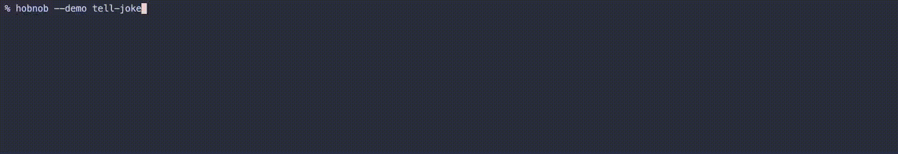

# hobnob

[](https://github.com/jakesmd/hobnob/actions/workflows/ci.yml)
[](https://github.com/jakesmd/hobnob/releases/latest)
[](LICENSE)

Another YAML task runner, except:

- **Tasks return values.** Query an API from any step, use the response for the
  rest of the run.
- **A form is just a step.** Text, single or multi select, built from an earlier
  step's output.
- **JSON is data, not text.** Dot into it ten steps later, at any depth.
- **Nothing to memorize.** Bare `hobnob` opens a menu of tasks, and whatever
  a task needs, it prompts for.

## 📦 Install

```bash
curl -fsSL https://github.com/jakesmd/hobnob/releases/latest/download/install.sh | bash
```

One static Go binary, nothing else to install.

## 👀 Try it

```bash
hobnob --demo ask-trivia
```



That runs this file:

```yaml
tasks:
  ask-trivia:
    info: Answer a trivia question from a category you pick.
    steps:
      # Query an API. The response is a value now.
      - run: curl -fsS https://the-trivia-api.com/v2/categories
        into:
          - CATEGORIES: stdout

      # The menu is built from what that step returned.
      - get:
          - CATEGORY:
              info: Which category?
              options: .CATEGORIES | keys

      # A sub-task, handing back a value.
      - call: _fetch-question
        into:
          - TRIVIA: .RESPONSE[0]

      # Shuffle the answers, so the right one isn't always first.
      - run: [sh, -c, 'printf "%s\n" "$@" | sort -R', answers, .TRIVIA.correctAnswer, .TRIVIA.incorrectAnswers]
        into:
          - ANSWERS: stdout | lines

      # Dot straight into the JSON. No parsing step.
      - get:
          - GUESS:
              info: "{{ .TRIVIA.question.text }}"
              options: .ANSWERS

      - run: echo "Correct!"
        if: "{{ eq .GUESS (.TRIVIA.correctAnswer | trim) }}"
      - run: 'echo "Not quite. It was {{ .TRIVIA.correctAnswer | trim }}."'
        if: "{{ ne .GUESS (.TRIVIA.correctAnswer | trim) }}"

  _fetch-question:
    steps:
      # Look up the chosen category's id by name.
      - run: curl -fsS "https://the-trivia-api.com/v2/questions?limit=1&categories={{ .CATEGORIES[.CATEGORY][0] }}"
        into:
          - RESPONSE: stdout
```

It reads like a book, and runs like one.

## 📖 Docs

The [hobnob guide](GUIDE.md) builds a working file from scratch. The
[reference](REFERENCE.md) has every field, filter and flag.

## 🤖 GitHub Action

Add hobnob to any workflow:

```yaml
steps:
  - uses: jakesmd/hobnob@v0
    with: # Pin any released version, or omit `with:` for the latest
      version: v0.8.0

  - run: hobnob deploy
```

## 🤝 Contributing

Got ideas or fixes? Check out the [Contributing guide](CONTRIBUTING.md) to see
how to get involved and submit a PR.
